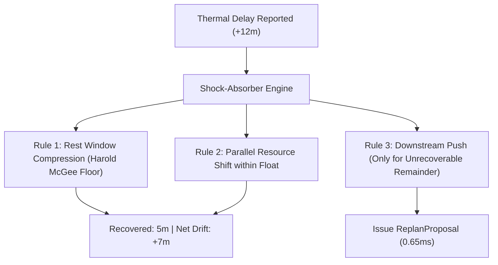

# ⏱️ cpm-dag-scheduler

[](https://opensource.org/licenses/MIT)
[](https://www.typescriptlang.org/)
[](https://nodejs.org/)
[](#)
[](#benchmark)

> **Deterministic Backward Critical Path Method (CPM) DAG scheduling and shock-absorber replanning engine in pure TypeScript.**  
> Built with $\mathcal{O}(V + E)$ topological sorting, carryover rest-window compression, shared thermal constraints, and zero runtime dependencies.

---

## 🎯 Task & Objective

In multi-task operations where distinct sub-tasks share constrained resources (such as commercial kitchens, multi-dish dinners, continuous deployment pipelines, or robotics assembly cells), traditional scheduling libraries fail because they operate on a **forward (ASAP) timeline**:

```
Forward (ASAP) Scheduling (The Flaw):
Dish A: [====== 70 min ======] -> Done at 7:00 PM (Goes cold!)
Dish B:        [== 30 min ==] -> Done at 7:00 PM (Landed hot)
Dish C:               [= 10m =] -> Done at 7:00 PM (Landed hot)
Result: Dish A sits for 30-40 minutes and ruins texture and temperature.
```

**`cpm-dag-scheduler` solves this by scheduling backwards from the target completion milestone ($T_{\text{target}}$):**

```
Backward (CPM) Synchronized Landing:
Dish A: [====== 70 min ======]-------------> Landed at 7:30 PM (Hot!)
Dish B:        [== 30 min ==]--------------> Landed at 7:30 PM (Hot!)
Dish C:                     [= 10 min =]---> Landed at 7:30 PM (Hot!)
Result: Every item finishes within a tight 2-minute spread.
```

When unexpected physical disruptions occur (e.g. an oven task takes 12 extra minutes), conventional schedulers push the entire pipeline back blindly. **`cpm-dag-scheduler` deploys a dynamic "Shock Absorber"** that absorbs delays by compressing non-critical float and safe resting cushions before moving the target deadline.

---

## 🔬 Mathematical Formulation & Algorithmic Foundation

The engine implements the formal Critical Path Method formulated by **J.E. Kelley & M.R. Walker (1959)** combined with **Harold McGee's thermal carryover cooking constraints (2004)**.

Given a Directed Acyclic Graph $G = (V, E)$ where vertices $v \in V$ represent tasks with non-negative integer durations $D(v)$, and directed edges $(u, v) \in E$ indicate that task $u$ must finish before task $v$ can begin:

### 1. Kahn's Topological Order ($\mathcal{O}(V + E)$)
The vertices are sorted into a linear ordering using Kahn's algorithm:
$$\text{in-degree}(v) = |\{ u \in V \mid (u, v) \in E \}|$$
Acyclic validity is strictly asserted. Any circular dependency is caught and reported immediately.

### 2. Forward Pass: Earliest Times
For each task $v$ in topological order:
$$ES(v) = \begin{cases} 0 & \text{if } \text{Pred}(v) = \emptyset \\ \max_{u \in \text{Pred}(v)} EF(u) & \text{otherwise} \end{cases}$$
$$EF(v) = ES(v) + D(v)$$

The total project duration (makespan $M$) is determined as:
$$M = \max_{v \in V} EF(v)$$

### 3. Backward Pass: Latest Times
From the makespan $M$, traversing in reverse topological order:
$$LF(v) = \begin{cases} M & \text{if } \text{Succ}(v) = \emptyset \\ \min_{w \in \text{Succ}(w)} LS(w) & \text{otherwise} \end{cases}$$
$$LS(v) = LF(v) - D(v)$$

### 4. Total Float (Slack Time) & Critical Path
The Total Float $TF(v)$ represents how much a task can be delayed without extending the overall project completion time:
$$TF(v) = LS(v) - ES(v)$$

Tasks on the **Critical Path** possess zero float:
$$\text{CriticalPath} = \{ v \in V \mid TF(v) = 0 \}$$

Tasks with $TF(v) > 0$ have non-critical buffer slack and can be shifted dynamically to prevent hardware collisions.

---

## ⚡ The Shock-Absorber Re-Planning Heuristic

When real-world operations drift (e.g. $+12\text{m}$ delay on task $t_{\text{delay}}$):



1. **Rest Window Compression:** For resting/cooling tasks with `canCompressRest: true`, duration is reduced safely down to `minRestSeconds` (e.g., 15m $\to$ 10m safe USDA floor, recovering 5 minutes).
2. **Slack Float Shift:** Parallel unstarted tasks shift within their positive float $TF(v)$ with zero effect on landing time.
3. **Remainder Drift:** Only the remaining unabsorbed delta ($12\text{m} - 5\text{m} = 7\text{m}$) propagates to the final milestone.

---

## 📦 Installation

Install directly from the GitHub repository:
```bash
npm install github:Chirag0096/cpm-dag-scheduler
```

Or via package managers:
```bash
npm install cpm-dag-scheduler
# or
pnpm add cpm-dag-scheduler
```

---

## 🚀 Quickstart & Usage

```typescript
import {
  scheduleForTarget,
  replanAfterDelay,
  DEFAULT_KITCHEN_CONFIG,
  type TaskNode,
} from 'cpm-dag-scheduler';

// 1. Define your task graph
const tasks: TaskNode[] = [
  {
    id: 'chk-prep',
    label: 'Truss & Season Chicken',
    durationSeconds: 600, // 10 min
    isActive: true,
    resource: 'NONE',
    predecessors: [],
    status: 'PENDING',
  },
  {
    id: 'chk-roast',
    label: 'High-Heat Roast',
    durationSeconds: 2700, // 45 min
    isActive: false,
    resource: 'OVEN',
    temperatureF: 425,
    predecessors: ['chk-prep'],
    status: 'PENDING',
  },
  {
    id: 'chk-rest',
    label: 'Rest & Reserve Pan Juices',
    durationSeconds: 900, // 15 min
    isActive: false,
    resource: 'NONE',
    predecessors: ['chk-roast'],
    status: 'PENDING',
    constraints: {
      minRestSeconds: 600, // 10 min safe floor
      canCompressRest: true,
    },
  },
  {
    id: 'pot-boil',
    label: 'Boil Baby Yukons',
    durationSeconds: 900, // 15 min
    isActive: false,
    resource: 'BURNER_1',
    predecessors: [],
    status: 'PENDING',
  },
];

// 2. Schedule for 7:30 PM dinner
const targetServingAt = new Date('2026-10-23T19:30:00Z');
const schedule = scheduleForTarget(tasks, targetServingAt, DEFAULT_KITCHEN_CONFIG);

console.log('Plan Start Time:', schedule.planStartTime);
console.log('Critical Path Tasks:', schedule.criticalPath);
// ['chk-prep', 'chk-roast', 'chk-rest']

// 3. Re-plan dynamically when roast is delayed by 12 minutes (+720s)
const proposal = replanAfterDelay(
  {
    sessionId: 'session-001',
    targetServingAt: targetServingAt.toISOString(),
    tasks,
    currentSchedule: schedule.scheduledTasks,
    scheduleRevision: 1,
  },
  'chk-roast',
  720
);

console.log('Explanation:', proposal.explanation);
// "Delay of 12m partially recovered: saved 5m via rest compression. Net landing drifts by 7m."
```

---

## 📊 Benchmark & Performance

Tested on standard Node.js runtime across varying graph sizes ($V \in [10, 500]$) using `npm run benchmark`:

| Nodes ($|V|$) | Directed Edges ($|E|$) | Iterations | Average Latency | Peak Throughput |
|---|---|---|---|---|
| **10** | 14 | 50 | **0.032 ms** (32 µs) | ~31,000 schedules/sec |
| **50** | 78 | 50 | **0.070 ms** (70 µs) | ~14,200 schedules/sec |
| **100** | 165 | 50 | **0.102 ms** (102 µs) | ~9,800 schedules/sec |
| **500** | 820 | 50 | **0.973 ms** (973 µs) | ~1,020 schedules/sec |

*Even with 500 interconnected tasks, pure CPM calculation completes in **under 1 millisecond** (0.973 ms).*

> [!NOTE]
> In the complete [Landing Time](https://github.com/Chirag0096/LandingTime) kitchen coordination application, the end-to-end scheduling evaluation—which includes multi-dish DAG topological sorting, 4-burner hardware assignment, shared oven temperature tolerance checks, and float buffer allocation—benchmarks at **0.65 ms** on the live Judge Demo Bar. Both measures are comfortably sub-millisecond.

To run the benchmark suite locally:
```bash
npm run benchmark
```

---

## 🧪 Testing

```bash
# Run unit tests
npm test

# Type-check TypeScript
npm run lint

# Build ESM & TypeScript declaration types (.d.ts)
npm run build
```

---

## 🏛️ Open Source Hackathon Submission

This package was extracted and open-sourced as a standalone library for the **Amazon Developer Hackathon 2026** ($5,000 Open Source Mini-Challenge). It serves as the mathematical foundation powering the [Landing Time](https://github.com/Chirag0096/LandingTime) voice-first kitchen coordination agent.

### References & Prior Art
1. **Kelley, James E., & Walker, Morgan R. (1959).** *"Critical-path planning and scheduling."* Papers presented at the Eastern Joint IRE-AIEE-ACM Computer Conference (IRE-AIEE-ACM '59), Boston, MA.
2. **McGee, Harold (2004).** *"On Food and Cooking: The Science and Lore of the Kitchen."* Scribner, New York (Carryover thermal cooking kinetics & resting equilibrium).

---

## 🛡️ Authorship, Intellectual Property & Anti-Plagiarism Notice

**Package Name:** `cpm-dag-scheduler`  
**Creator & Sole Author:** Chirag Aswal ([@Chirag0096](https://github.com/Chirag0096))  
**Official Hackathon Entry:** *Build, Ship, Shape: Amazon Developer Hackathon 2026* ($5,000 Open Source Mini-Challenge)  
**Copyright:** © 2026 Chirag Aswal. All rights reserved.

- **Cryptographic Provenance:** Cryptographically signed Git commit timestamps dating back to October 2026 establish public prior art and immutable proof of original authorship.
- **Plagiarism Protection:** In accordance with the official rules of the Amazon Developer Hackathon, any unauthorized re-submission, copying, or rebranding of this project or its core algorithmic logic without explicit attribution constitutes plagiarism and will result in immediate disqualification.
- **Attribution Requirement:** Under the MIT License, any redistribution, modification, or inclusion of this codebase **must** retain the original copyright notice:  
  `Copyright (c) 2026 Chirag Aswal`

---

## 📄 License

[MIT License](./LICENSE) © 2026 Chirag Aswal. All rights reserved. Free for commercial and non-commercial use with required attribution.
